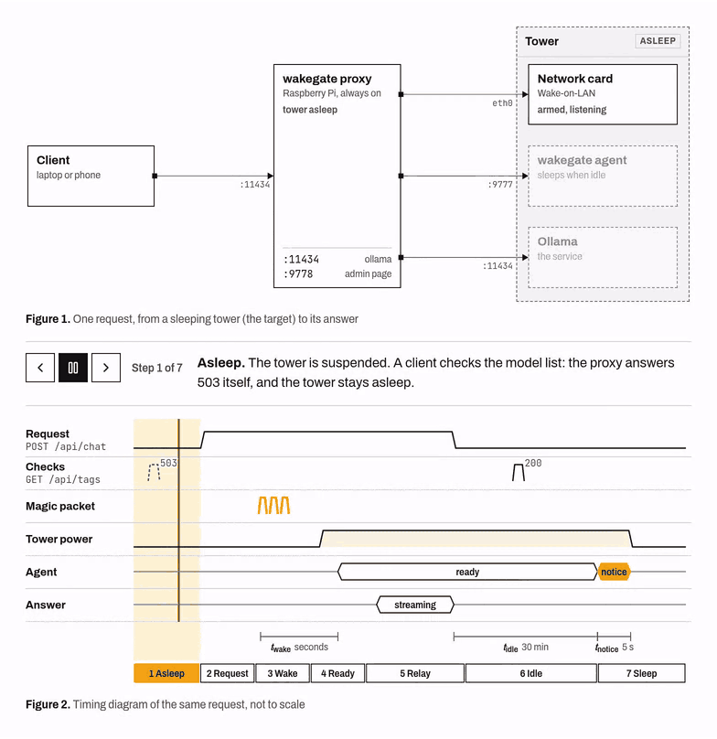
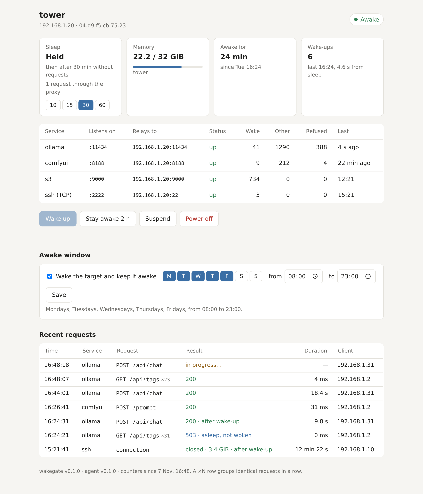

# wakegate

Wake a computer when a request needs it. Let it sleep when nothing does.

wakegate is for a computer you want available but not always on: a tower with a GPU
that serves a local LLM, a machine that receives backups, a server you use a few hours a
day. A small machine that stays on, such as a Raspberry Pi, runs the wakegate **proxy**.
It listens in place of the computer's services, wakes the computer with Wake-on-LAN when
a request needs it, holds the request until the service answers, then relays it. The
wakegate **agent**, on the computer, puts it back to sleep once nothing has needed it
for a while.

```
                always on                                 sleeps when idle
┌────────┐    ┌───────────────────┐   relays requests    ┌────────────────────────┐
│ client │───►│  wakegate proxy   │─────────────────────►│ Ollama, SSH, S3…       │
└────────┘    │                   │   magic packet       │                        │
              │  Raspberry Pi,    │─────────────────────►│ network card           │
              │  mini PC, router  │   heartbeat, state   │                        │
              │                   │◄────────────────────►│ wakegate agent         │
              └───────────────────┘                      └────────────────────────┘
```



- A request that needs the computer wakes it, waits for the service, then goes through.
  Streamed answers (an LLM's tokens, server-sent events) and WebSockets are relayed as
  they come.
- Requests that only check on a service, such as a model list or a health probe, get a
  `503` while the computer sleeps: a client that polls does not keep it awake. You choose
  which requests wake it, per service.
- A browser that opens a page gets a page that reloads by itself until the service is up.
- Raw TCP for SSH, rsync, Borg or restic over SFTP: a connection wakes the computer and
  holds it awake until it closes.
- The agent suspends the computer (or hibernates it, or powers it off) after a period
  without requests, unless someone is logged in, a program holds a systemd sleep
  inhibitor, or a command you configure reports work in progress.
- A request that arrives while the computer is going to sleep calls the sleep off if it
  can, or waits and goes through once the computer is awake again.
- An optional admin page shows the computer's state and what keeps it awake, the requests
  per service and the latest ones, and has buttons to wake it, suspend it or keep it
  awake, the idle timeout, and an awake window (wake it on weekdays at 8:00, keep it
  awake until 23:00). Prometheus metrics are at `/metrics`.
- One static binary of about 10 MB for both sides, with a single dependency, a YAML
  parser.



## Requirements

- **The computer that sleeps** (the target): a wired network card that supports
  Wake-on-LAN. The agent runs on Linux with systemd. Without the agent, on Windows or
  macOS for instance, the proxy still wakes the computer and relays its requests, and the
  computer manages its own sleep.
- **The machine that stays on**: Linux, on the same network as the target. Releases
  are built for amd64, arm64, armv7 and armv6 (every Raspberry Pi). The proxy can use
  Wi-Fi; the target, for Wake-on-LAN, should not.

## Quick start

**1. Prepare the target.** Turn on Wake-on-LAN in its firmware and its operating system,
then check that it wakes up from sleep: [docs/target.md](docs/target.md). This is the
only step that depends on your hardware.

**2. Install the agent on the target.**

```sh
curl -fsSL https://raw.githubusercontent.com/lmdr-org/wakegate/main/install.sh | sudo sh -s -- agent
sudo systemctl enable --now wakegate-agent
```

The installer creates a `wakegate` user, `/etc/wakegate/agent.yaml`, a token in
`/etc/wakegate/agent.token`, a polkit rule that lets the agent suspend the computer, and
the `wakegate-agent` service. By default, the computer suspends after 30 minutes without
requests. The installer ends with the command to run on the proxy, token included.

**3. Install the proxy on the machine that stays on.**

```sh
curl -fsSL https://raw.githubusercontent.com/lmdr-org/wakegate/main/install.sh | sudo sh -s -- proxy --agent-token <token>
sudoedit /etc/wakegate/proxy.yaml
wakegate proxy -check
sudo systemctl enable --now wakegate-proxy
```

In `proxy.yaml`, set the target's address and MAC address, and its services:

```yaml
target:
  name: tower
  host: 192.168.1.20
  mac: "04:d9:f5:cb:75:23"
  broadcast: [192.168.1.255]
  agent: http://192.168.1.20:9777

admin:
  listen: ":9778"

services:
  - name: ollama
    listen: ":11434"
    upstream: 11434
    wake_on: [POST /api/generate, POST /api/chat, POST /api/embed, POST /v1/*]
```

**4. Point the clients at the proxy**: `http://raspberrypi:11434` instead of
`http://tower:11434`. A client that talks to the target directly is invisible to
wakegate: it neither wakes the target nor keeps it awake.

You would rather not pipe a script into a shell? Download the archive for your machine
from the [releases](https://github.com/lmdr-org/wakegate/releases), check it against
`SHA256SUMS`, extract it and run `sudo ./install.sh agent` (or `proxy`) from inside.
`install.sh uninstall` removes wakegate.

## Adding a service

Add an entry under `services`, check the file and restart the proxy:

```yaml
  - name: comfyui
    listen: ":8188"
    upstream: 8188
    wake_on: [POST /prompt, POST /api/prompt, POST /upload/*, POST /api/upload/*]
```

```sh
wakegate proxy -check && sudo systemctl restart wakegate-proxy
```

On the target, the service must start at boot and listen on the network, not only on
`127.0.0.1`. [docs/services.md](docs/services.md) has entries for Ollama,
OpenAI-compatible servers (llama.cpp, vLLM, LM Studio), ComfyUI, S3 storage, restic and
SSH; [docs/configuration.md](docs/configuration.md) describes every setting.

## What happens to a request

| The target is | A request that may wake it | Another request | A browser opening a page |
|---|---|---|---|
| awake | relayed | relayed | relayed |
| asleep or off | wakes it, waits, relayed | `503`, `Retry-After: 60`; not woken | waiting page; wakes it |
| going to sleep | calls the sleep off, or waits for the wake-up | relayed | waiting page |

A request that may wake the target also keeps it awake: the idle timeout restarts when
it ends. If the target went to sleep under a request, the proxy wakes it and sends the
request again (bodies up to `max_body_mb`, 16 MiB by default; larger ones are streamed
and sent once). A request waits up to `boot_timeout` (3 minutes) for the target, then
gets a `504`. Services that call the proxy before working can also send
`POST /__wake`, which answers `200` once the service is up.

Waking from suspend takes a few seconds; from power off, the time the computer takes to
boot. Some clients give up sooner: nginx's `proxy_read_timeout`, for instance, is 60
seconds by default.

## Admin page and metrics

With `admin.listen` set, the proxy serves the page above, its JSON API and `/metrics`.
The page has no login: anyone who reaches it can wake the target or put it to sleep, so
keep it on your network, or behind a reverse proxy that asks for one. Browsers do not let
another site trigger its actions. API: [docs/api.md](docs/api.md).

## Security

- Both sides run as an unprivileged `wakegate` user, under systemd's sandboxing. The
  agent's only power is a polkit rule that lets that user suspend, hibernate or power off
  the computer. Sleep inhibitors still apply.
- Every agent route except `GET /healthz` needs the token from
  `/etc/wakegate/agent.token`.
- The proxy relays plain HTTP and TCP, like the services behind it. For HTTPS, put a
  reverse proxy such as Caddy in front of it.

## Running the proxy in Docker

The image needs the host's network, for the magic packets and the service ports:

```sh
docker run -d --name wakegate --network host --restart unless-stopped \
  -v ./proxy.yaml:/etc/wakegate/proxy.yaml:ro \
  -v ./agent.token:/etc/wakegate/agent.token:ro \
  -v wakegate-state:/var/lib/wakegate \
  -e TZ=Europe/Paris \
  ghcr.io/lmdr-org/wakegate
```

`TZ` sets the time zone of the awake window. The agent does not run in a container: it
needs the host's logind.

## Questions

**Can the proxy run on a VPS?** Magic packets do not cross routers. The proxy then needs
a way into the target's network, such as WireGuard or Tailscale, and something on that
network to wake the target: `wake_command` runs any command instead of sending the
packet, for instance `ssh router etherwake <mac>` or a call to Home Assistant.

**Does the computer sleep while I use it?** Not while you are logged in, at the console
or over SSH (`keep_awake.sessions`), nor while a program holds a sleep inhibitor. To run
a long job, wrap it in `systemd-inhibit --what=sleep <command>`. The admin page shows what
keeps the computer awake.

**What about Windows or macOS?** Run the proxy without an agent and let the target's own
power settings decide when it sleeps: [docs/target.md](docs/target.md#without-the-agent).

**Containers on the target?** They need a restart policy (`restart: unless-stopped`) so
they come back after a boot. Suspend keeps them running.

## Building

Go 1.25 or later:

```sh
go install github.com/lmdr-org/wakegate@latest
# or, from a clone
go build -o wakegate . && sudo ./install.sh agent
```

`go test -race ./...` runs the tests. `scripts/release.sh vX.Y.Z` builds the release
archives.

## License

MIT. wakegate grew out of a home setup where a tower with a GPU serves LLMs, image
generation and backups to the rest of the house, and sleeps the rest of the time.
